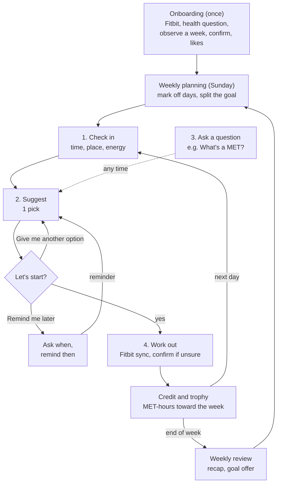

# Make It Count: Personal Health Agent (demo)

A mobile-style web app that helps busy adults **raise their VO2 max** without having to plan. Each day it
hands the user one workout that fits their time, the equipment where they are and the activities they
enjoy, counts it in MET-hours toward the weekly physical activity guideline (the training that builds VO2
max), and rewards them with a streak for showing up and a trophy for every week they reach their goal.

**Live demo:** https://jarvistseca.github.io/personal-health-agent/ (redeploys on every push to `main`)

This is the **demo build**: every screen is interactive, Fitbit data (including VO2 max) is simulated, and
the agent answers from pre-written scripts. It follows the team's *PHA App Workflow* doc. The code is organized
so a real LLM and a database can be plugged in later without rewriting the screens.

**Team:** Kate Tan (clinical informatics / CS), Sarah Danziger, MD (medicine / health),
Jarvis Tse (HCI / design / CS)

## Run it

Requires Node 18 or newer.

```bash
npm install
npm run dev
```

Open the URL Vite prints (usually http://localhost:5173). On a laptop you'll see the app inside a
phone frame with demo controls beside it. On a phone (or a narrow window) the app fills the screen.
To try it on your phone, connect to the same Wi-Fi and open the "Network" URL Vite prints.

| Command | What it does |
|---|---|
| `npm run dev` | Start the dev server with hot reload |
| `npm run build` | Typecheck and build to `dist/` |
| `npm run preview` | Serve the built app locally |
| `npm test` | Run the unit tests for the MET-hour math, targets, streaks and trophies, goal rules, equipment, ranker and Today flow |
| `npm run typecheck` | TypeScript check only |

**With the Python backend (Jev + SQLite):** start it on port 8000 as described in
[docs/architecture.md](docs/architecture.md#run-it), then run `npm run dev` as usual. Suggestions then come from Jev
and the app's data is saved in SQLite. Without the backend, the app works exactly as the demo above.

## What's in the demo

The app has five tabs: **Today · Progress · Chat · Clinician · Showcase**. Onboarding runs once before
them, and Preferences opens as a sheet from Today.

### The mission: VO2 max

The app is pitched around raising **VO2 max**, the most oxygen the body can use during hard exercise and one
of the best single measures of cardio fitness. It's better known than MET-hours, so it leads: on the welcome
screen, at the top of Progress and on the Today card.

MET-hours stay the weekly unit, because they're what the guideline is written in and what the app can count
from each workout. The app is careful about how the two connect:

- **MET-hours are the training, VO2 max is the result.** VO2 max rises over weeks to months of regular
  activity; the app never says a workout "adds" VO2 max.
- **One MET is 3.5 mL of oxygen per kg per minute**, so a VO2 max of 41 mL/kg/min reads as about 11.7 METs at
  the user's peak. That's the one number that ties the two together.
- **The VO2 max number is Fitbit's estimate** (it was called the Cardio Fitness Score), shown once a month
  with its trend. In the demo it's simulated. Fitbit currently estimates it from outdoor runs with GPS, so a
  user who never runs may not get a reading; the card says so when there's none yet.

Code: `src/components/Vo2Card.tsx`, `src/services/context.ts` (`vo2Of`), `src/services/answers.ts` (`vo2`)

### Onboarding (runs once)

**Observe first**: connect Fitbit, tell the agent anything it should know about your health, watch a week,
then confirm what was detected, add liked activities (ranked), tell the agent your **equipment**, and plan
the first week (every day starts at 10 min). *Set up now* skips the week. Every page has *Back*.

**Equipment, one place at a time.** First *What do you have at home?*, then *Do you go to a gym?* and, if
yes, *What does your gym have?* On each page the user can **take a photo**, **type a list** ("two dumbbells
and a mat") or tap chips. The photo and the typed list fill in the chips, which the user can fix. In the
demo, photo recognition is simulated (a typical set for that place) and the photo stays on the device.

Code: `src/screens/Onboarding.tsx` (`GearPicker`), `src/lib/equipment.ts`

### Today

The daily loop, and the screen the app opens on.

- **Summary card:** a bar for the week's MET-hours and one for today's target, with a legend (*Done* green,
  *Left for today* amber, *Upcoming days* gray). Below them, three rewards at a glance: the **streak**
  (days in a row the app was opened), what's left to **this week's trophy**, and **VO2 max** with its trend.
  Each opens Progress.
- **"This agent is a machine learning model and may make mistakes"** sits at the top of the conversation,
  as it does in Chat.
- **Check-in:** bubbles for time (*Off*, 0, 5, 10, 30, 45+ min), where they'll exercise (**Home, Gym**,
  Office, Outside) and how they feel. *Gym* is hidden for someone who said they don't use one. *Off* makes
  today a day off; *0 min* offers desk moves.
- **Edit an answer:** tap any answer you sent for its time and a pencil, which goes back to that question.
- **Suggestion:** one pick, three buttons: *Let's start*, *Remind me later* (the agent asks when) and
  *Give me another option*. The pick only uses equipment that's where the user is today ("Uses the
  stationary bike at your gym"). Strength and interval picks list a **circuit built from that equipment**
  (dumbbells → goblet squats and dumbbell rows; nothing → bodyweight squats and incline push-ups).
- **Show me how:** a chip under the pick (and typing "how do I…") makes the agent share a **short how-to
  video**, one move at a time: setting up a spin bike, the salsa basic step, rowing technique, goblet squats
  and so on. The video plays in the conversation (YouTube's privacy-enhanced player, loaded on tap).
- **Questions:** chips such as *What's a MET?*, *Why this?*, *How did you calculate this?* and *What's VO2 max?*
- **Workout:** *Sync Fitbit* logs it, asks to confirm if unsure, and nudges *keep going*. Reaching the
  weekly goal brings the **trophy moment**.
- **After a clinician visit:** the agent says once that it has read the clinician's notes and that the
  user's goals stay theirs to set.
- The settings button opens **Preferences**: ranked activities with access, **equipment at home and at the
  gym**, **the clinician's notes** (readable and removable), what the agent remembers (declines and notes),
  the health flag, Fitbit, and a shortcut to the Clinician tab.

Code: `src/screens/TodayScreen.tsx`, `src/state/today.ts`, `src/lib/moves.ts`, `src/components/VideoCard.tsx`,
`src/screens/PreferencesSheet.tsx`

### Progress

One tab for how activity adds up. Top to bottom:

- **Your VO2 max:** the latest estimate, its monthly trend and what it means in METs.
- **This week:** MET-hours done against the goal, the same legend and bars as the Today card, then two
  reward cards: **this week's trophy** (earned, or how much is left) with the trophy count, and the
  **streak** with the best run so far. The line under the heading says where the goal came from (guideline,
  raised, or stepping stone).
- **Day by day:** each day's target and workouts, with a green check on days with activity and a quiet circle
  otherwise. *Update my goals* sets each day to *Off* or 0, 5, 10, 30 or 45+ min and re-splits what's left.
  *Log a workout Fitbit missed* adds one by hand.
- **Last week:** the recap: total, the trophy if earned, which days were active, a line of praise and the
  activity with the most time. Below it, the goal offer: raise, lower or keep, or type your own goal.
- **Month by month:** pick a month with the *Year* and *Month* dropdowns. The month shows its **trophies**,
  its **best streak**, and days with the app, then a calendar: a row per week, a **flame on each day the app
  was opened**, days in a row joined into one band so **past streaks** read at a glance, and a **trophy** at
  the end of each week that reached its goal (that row is gold). Days the app wasn't opened are plain dots.
- **How rewards work:** the streak and the trophy, in two lines.

Code: `src/screens/ProgressScreen.tsx`, `src/components/Rewards.tsx`, `src/components/Vo2Card.tsx`,
`src/lib/periods.ts`, `src/lib/rewards.ts`

### Chat

A chat for free-form questions (the old Coach tab), answered from scripts with the user's real numbers.
The top of the conversation says the agent is a machine learning model and may make mistakes. It answers
VO2 max questions, brings in the **clinician's notes** when they're relevant ("What did my clinician
suggest?", today's pick, the goal), and keeps the guardrail for pain or dizziness. Tap a message you sent to
edit it (*Cancel* / *Save*); saving asks again and replaces the reply. Old `#coach` links open Chat.

Code: `src/screens/ChatScreen.tsx`, `src/services/mockResponses.ts`

### Clinician

Used at a visit, on the user's own phone, so no clinician account is needed. **The clinician reviews and
suggests; the user decides.**

- **Consent first.** Every time the tab opens, a pop-up asks: *"Share your summary with your clinician?
  If you'd like your clinician to review your activity, please hand your phone to them now. They'll see a
  summary of your records and can leave notes for the agent. You'll decide on any changes to your goals
  together."* *Not now* goes back to the previous tab.
- **At a glance:** a few plain sentences (average MET-hours over the last 4 weeks, as a share of the
  guideline and in minutes of moderate activity; weeks at goal and active days; main activities and the share
  of vigorous minutes; VO2 max trend; the current goal, set by the user), then four key numbers.
- **To discuss:** health condition, pain reports, health-related things the user typed, the longest stretch
  without activity, and why workouts get skipped.
- **Detail:** weekly MET-hours for the last 6 weeks against each week's goal, and the activity mix.
- **Notes for the agent (optional):** name, role and free-text suggestions, with one-tap starters (*Build
  up gradually*, *Moderate intensity only for now*, *Add two strength days a week*, *Stop and call if…*).
  The agent uses the notes as **context** in later conversations. They don't change the goal or any limit.
- **Hand back:** *Save notes and hand back* (or *Done, hand back* with no changes). The user and clinician
  talk it through in person, and the user changes their goal on Progress if they decide to.

Code: `src/screens/ClinicianScreen.tsx`, `src/services/clinicianSummary.ts`

### Showcase

The **demo moment** from the one-pager. It works without onboarding. Pick two or three activities, see
what 30 minutes of each is worth, and compare three weeks: *too little*, *overdid it* and *with the agent*,
with the agent's plan expandable. Each week shows its active days and a trophy if it reached the goal.

Code: `src/screens/ShowcaseScreen.tsx`

**Typing is always an option.** Every question that offers buttons or bubbles also has an *Other* text box
below them. Typed answers are read into the same choices (`src/lib/freeText.ts`): "25 min", "at the gym",
"my knee is sore" (takes the safety path), "pickleball", "two dumbbells and a mat". Anything the app can't
place is kept as a note the agent remembers (shown in Preferences), and an activity outside the list keeps
the user's name for it and counts at the bottom of the effort band Fitbit measured.

**Demo controls** (right side on desktop): switch scenario (*Alex*, *On a roll* → goal raise, *Tough month*
→ goal cut, *Fresh start*), pretend it's a different day, restart today's check-in, simulate a Fitbit
sync, **show the how-to video example** (30 min at the gym → a pick with a video → *Show me how*),
**simulate a clinician visit** (adds sample notes from "Dr. Rivera"), jump to Progress or the Clinician
tab, reset, and show the backend: the **verifier's checks** on the current suggestion and the prompt the
agent would receive.

## Changes on Oct 28, 2026

Eight changes requested for the web app demo, what was built for each, and why. The tab-by-tab details
are above in *What's in the demo*; the short form of each decision is also in the *Design decisions* log
below. Merged in pull request #13.

### 1. Clinician tab: a summary to check, notes for the agent, goals stay with the user

**What changed:** The tab now opens (after consent) on a digestible summary of the user's data: a few
plain sentences (average MET-hours over the last 4 weeks, as a share of the guideline and as minutes of
moderate activity; weeks at goal; active days; main activities and share of vigorous minutes; VO2 max
trend; the current goal and who set it), four key numbers, things to discuss (health condition, pain
reports, health-related notes the user typed, the longest stretch without activity, why workouts get
skipped), the weekly MET-hour chart and the activity mix. Below it is an optional notes box (name, role,
free-text suggestions, with one-tap starters). The goal template (MET-hours, intensity, session length,
review date, precautions) is gone, and nothing the clinician enters changes the goal or any limit.
After hand-back, the agent mentions once on Today that it has read the notes, uses them in Chat replies
when they're relevant, and gets them in its context as `clinician_notes`. The user can read and remove
the notes in Preferences.

**Why:** The clinician's job is to check the summary and suggest; the user makes the final decisions about
their goals. After the visit the user and clinician talk directly, so the app doesn't need to turn the
clinician's input into settings. Keeping the notes as agent context means the suggestions still shape
what the agent says without overriding the user. The summary leads with sentences and a handful of
numbers because a clinician has minutes, not a dashboard's worth of time, during a visit. The notes are
visible to the user because they're about the user, and the user should know what the agent is using.

### 2. "Coach" is now "Chat", with a machine-learning notice

**What changed:** The tab is renamed Chat (old `#coach` links still open it). The top of every
conversation, on Chat and on Today, says: "This agent is a machine learning model and may make mistakes.
It isn't medical advice; check anything important with your clinician." The agent's brief says the same.

**Why:** "Chat" says what the tab is. Users should know they're talking to a model that can be wrong,
before they read anything it says. Today is also a conversation with the agent, so it gets the notice too.

### 3. A how-to video in the Today conversation

**What changed:** Under a pick (and after *Let's start*), a *Show me how* chip makes the agent share a short
how-to video in the conversation, one move at a time: setting up a spin bike, the salsa basic step,
rowing technique, goblet squats, dumbbell rows, band rows, kettlebell swings, bodyweight squats, incline
push-ups, lunges, planks, beginner burpees. Typing "how do I…" does the same. The video shows as a
thumbnail and loads YouTube's privacy-enhanced player only when tapped. The demo panel's *Show the how-to
video example* button replays the example conversation: 30 min, at the gym, normal energy, a stationary
bike pick, then *Show me how* and the bike-setup video.

**Why:** Some picks are easier to start once you've seen them done, and not knowing how to do a move is a
reason to skip it. Showing one move at a time keeps the conversation short. Loading the player on tap
keeps the page fast and doesn't contact YouTube until the user asks.

### 4. Gym as a place

**What changed:** Check-in's place question offers Home, **Gym**, Office and Outside. Typing "at the gym"
(or "YMCA", "fitness center") works too. Gym is hidden for users who said they don't use one. At the gym
the agent suggests indoor activities only.

**Why:** A gym day has different options than a home day, and the user needs to be able to say so in one tap.

### 5. Equipment in onboarding, by photo or text, one place at a time

**What changed:** After the activities page, onboarding asks *What do you have at home?*, then *Do you go
to a gym?* and, if yes, *What does your gym have?* On each page the user can take a photo, type a list
("two dumbbells and a mat") or tap chips; the photo and the typed list fill in the chips, which the user
can fix. Equipment can be changed later in Preferences.

**Why:** Asking about each place separately keeps each question small and matches how people think about
it ("at home I have…"). A photo is quicker than a list for most people; text and chips are there for
everyone else and for fixing mistakes.

### 6. Suggestions based on the equipment where the user is

**What changed:** The ranker only suggests an activity that needs equipment when that equipment is where
the user will exercise today, and it prefers the variant that uses it ("Uses the stationary bike at your
gym"). Strength and interval picks list a circuit built from the equipment on hand: dumbbells give goblet
squats and dumbbell rows, bands give band rows, nothing gives bodyweight squats and incline push-ups. New
Compendium entries make this possible: stationary bike (01216), treadmill walk (17358), superset circuit
(02055), kettlebell circuit (02040) and elliptical (02048, 02049). The verifier has a new equipment check.

**Why:** Modeled on Volt Athletics, which builds workouts from the equipment a user has. A pick the user
can't do with what's there is a wasted decision, which works against the app's purpose of removing
decision fatigue.

### 7. Simpler rewards: a sign-in streak and weekly trophies

**What changed:** Bronze, silver and gold daily medals are gone. There are two rewards. The **streak**
(a flame) counts days in a row the user opened the app. The **trophy** is earned for each week that
reaches its goal, and trophies are kept for good. Today shows the streak and what's left to this week's
trophy; reaching the goal brings a trophy moment. Progress shows both, with the best streak so far.
*Month by month* was redesigned to match: a flame on each day the app was opened, days in a row joined
into one band so past streaks read at a glance, and a trophy (on a gold row) for each week that reached
its goal. Days the app wasn't opened are plain dots.

**Why:** Three medal types per day were hard to read; one streak and one weekly trophy are easier to
follow. The app should only reward users and never penalize them. A missed day does end the streak, but
the app doesn't emphasize it: there's no "streak lost" message, no question about why, and the agent just
says "Welcome back." Showing the best streak means a past run still counts for something. Missed days in
the calendar are neutral dots rather than empty or crossed-out markers.

### 8. Rebranding around VO2 max

**What changed:** The app's pitch is now "raise your VO2 max." The welcome screen leads with it, Progress
opens with a VO2 max card (Fitbit's monthly estimate, its trend and what it means in METs), the Today card
shows it next to the streak and trophy, and the agent can answer *What's VO2 max?* MET-hours stay the
weekly unit and are explained as the training that raises VO2 max.

**Why:** VO2 max is better known than MET-hours and is one of the best single measures of cardio fitness,
so it makes a clearer goal to sell. It isn't the same thing as MET-hours, though: MET-hours measure the
work done, VO2 max is the fitness that work builds over weeks to months. The app keeps them separate so
the claims stay accurate. The one bridge it uses is that 1 MET is 3.5 mL of oxygen per kg per minute, so a
VO2 max of 41 mL/kg/min is about 11.7 METs at the user's peak. MET-hours stay the unit because the activity
guideline is written in them and they're what the app can count from each workout.

### Also added

- **Simulate a clinician visit** in the demo panel: adds sample notes from "Dr. Rivera" so the notes flow
  can be shown without filling in the tab.
- The backend (Jev) understands "gym" as a place.

### Things to know

- **VO2 max data.** Fitbit (now Google) estimates VO2 max only from outdoor runs with GPS on. A user who
  doesn't run, like the one-pager's user who cycles and dances, may never get a reading. The demo's numbers
  are simulated, and the VO2 max card says "no estimate yet" when there isn't one. Before real use, decide
  what the app shows for non-runners. Source: [Google Fitbit Help: VO2 max](https://support.google.com/fitbit/answer/14237924).
- **Videos.** The how-to videos are public YouTube tutorials picked for being short and beginner-friendly,
  from channels such as IU Health, NASM, Concept2, Children's Hospital Colorado and Spinning. All allow
  embedding. They should get a clinical review (Sarah), or be replaced by the team's own clips, before real
  users see them. The list is in `src/lib/moves.ts`.
- **Photo recognition.** It's simulated: a photo returns a typical set of equipment for that place, and
  the user corrects it with the chips. The photo never leaves the device. A real version needs a vision
  model and a decision about where photos are processed.
- **New MET values.** The new entries (01216, 17358, 02055, 02040, 02048, 02049) were transcribed from the
  [2024 Adult Compendium](https://pacompendium.com/adult-compendium/) on Oct 28, 2026. Like the rest of
  `src/lib/activities.ts`, they should be re-checked before anything beyond the demo.

## Design guidelines

The app is built from the team's design brief and the *PHA App Workflow* doc, including the decisions the
team made on its open questions. The one-line goal behind every feature: **take away decision fatigue by
telling the user what exercise to do.** It's for people with little time, or who don't want to think about
what to do, and once they start moving it encourages them to keep going.

The Workflow subsection shows how the features fit together. Each feature subsection after it gives the
instruction, then how the app follows it.

### Workflow

The app runs on three loops: onboarding once, planning every week, and a check-in every day.



1. **Onboarding (once).** The user connects Fitbit and answers one health question. The app then watches a
   week of Fitbit data. On day 8 the user confirms the workouts the app detected, adds activities they
   enjoy and plans the first week.
2. **Weekly planning (every Sunday).** The user marks the days they can't exercise. The weekly goal is split
   over the other days by how much time each one has. The plan can change mid-week, and what's left is
   re-split.
3. **The daily loop.**
   1. *Check in:* the user taps how much time they have, where they'll exercise and how they feel.
   2. *Suggest:* the coach gives one pick with three buttons: *Let's start*, *Remind me later* or *Give me
      another option*. A reason for turning it down can still be typed, and the coach saves it.
   3. *Ask:* at any point the user can tap or type a question, such as *What's a MET?*
   4. *Work out:* Fitbit syncs the workout and the user confirms it if the app isn't sure. It's converted to
      MET-hours, progress updates, and if the user got partway to today's target the coach nudges them to keep
      going. The rest of the week's targets adjust.
4. **Weekly review (end of week).** The *Last week* section of Progress shows last week's total and trophy,
   then offers to raise, lower or keep the goal. Planning the next week happens in the same tab.

The Clinician tab sits outside these loops. The user opens it during a visit and agrees to share their
records. The clinician reviews a summary and can leave notes, which the agent uses as context from then on.
Goals stay the user's to set.

### Onboarding

**Instruction:** Learn what the user already does from a week of Fitbit data, then confirm it with them and
ask for anything else they enjoy and can do.

- Observe first is the default: connect Fitbit, tell the coach anything it should know, then wear the Fitbit
  for a week while the coach makes no suggestions. The streak still counts during that week.
- Every page after the welcome has *Back* at the top, which returns to the page the user came from.
- On day 8 the coach shows each workout it detected ("Tuesday, 30 min, looks like cycling. Right?") and the
  user confirms, corrects or skips it.
- Then the user adds activities they enjoy (in order of preference), their equipment at home and at the gym
  (a photo, a typed list or chips; asked one place at a time), and plans the first week. Every day
  starts at 10 min; the user changes the days that differ (*Off*, 0, 5, 10, 30 or 45+ min).
- There's no access page and no "how much time most weeks" page. Everything starts as available; if the user
  can't do something, typing so when turning a pick down ("can't, my bike is broken") or setting it in Preferences
  rules it out from then on.
- *Don't want to wait? Set up now* skips the observation week.
- The health page starts with a large text box for anything the coach should know (a condition, an
  injury, medication, something to avoid), with *No health conditions* and *Prefer not to say* below it.
  What's typed is kept as a note the coach remembers. Typing something without picking *No health
  conditions*, or picking *Prefer not to say*, turns off vigorous suggestions and suggests checking with a
  clinician first.

Code: `src/screens/Onboarding.tsx`

### Weekly planning and daily targets

**Instruction:** Split the weekly goal across the days the user can exercise. Let them mark days they can't
exercise at all, and let them change the plan mid-week, with the remaining goal split over the remaining days.

- Each day is *Off* or 0, 5, 10, 30 or 45+ min, the same list as Today's time question. *0 min* means desk
  moves only, so it has no target but isn't a day off.
- The weekly goal never drops because of off days; their share moves to the other days, weighted by minutes.
- *Update my goals* works at any point; so does tapping *Off* at Today's time question. Every change, and every Fitbit sync, re-splits what's left.
- Today's target is fixed at the start of the day, so it doesn't move during a workout.

Code: `src/lib/plan.ts`, `src/screens/ProgressScreen.tsx`

### Daily check-in

**Instruction:** Ask for the user's preferences and availability each day.

- Three quick questions, each answered with one tap: time today (*Off*, or 0, 5, 10, 30 or 45+ min), where they'll
  exercise (home, gym, office, outside), and how they feel (*Up for a challenge* or *Normal*).
- There's no "what are you in the mood for?" question: the coach picks, to avoid decision fatigue.
- Feeling tired isn't a button, to nudge toward moving, but typing it works and the pick gets easier.
- *Up for a challenge* aims for 1.5× today's target, through a harder pace rather than a longer session;
  *Normal* aims for today's target.
- Answering *0 min* skips the rest and offers desk moves.

Code: `src/state/today.ts`, `src/screens/TodayScreen.tsx`

### Exercise suggestions

**Instruction:** Suggest an exercise for the day that fits the user's preferences, what they can access, their
time and their goal. Avoid repetition. Use their past feedback. If they have no time, suggest something they
can do at their desk.

- One pick on screen. The ranker keeps two backups (of a different type where possible) for *Give me
  another option*, which cycles through them.
- *Remind me later* asks when (in 30 min, in 1 hour, this evening, or a typed time) and brings the same pick
  back then.
- The ranker filters to activities the user enjoys, can access and has time for, that their health
  settings allow, and whose equipment is where they'll exercise today (at the gym, indoor activities only). It then scores them on preference, fit to today's target, how recently each was done, past
  declines and today's energy.
- Each card says why it was picked ("Your favorite", "Not done in the last few days").
- Strength and interval picks come with a circuit built from the equipment on hand, and *Show me how*
  shares a short how-to video for each move (`src/lib/moves.ts`).
- With 0 minutes, it offers desk moves with a resistance band.

Code: `src/lib/suggest.ts`

### Declining a suggestion

**Instruction:** The user can turn a suggestion down and say why. The coach remembers the reason and uses it
for later suggestions.

- There's no *Not today* button on the pick: typing a reason in the Other box ("my knee hurts", "no time")
  starts it. *Change of plans* on an accepted workout still offers the reasons as bubbles: no time, too tired,
  not in the mood, did this recently, can't access it, weather, something hurts.
- Each reason changes the next pick right away (shorter, lighter, indoors, a different type) and is saved.
  Preferences shows what the coach remembers, and the user can delete any of it.
- *Something hurts* always takes the safety path: gentle options only, vigorous suggestions off, and a
  prompt to check with a clinician.

Code: `src/state/today.ts`, `src/screens/PreferencesSheet.tsx`

### Clarification questions

**Instruction:** The user can ask questions (for example, "What is MET?") at any point.

- One-tap question chips sit under every suggestion: *What's a MET?*, *Why this activity?*, *How did you
  calculate this?*, *Does walking count?*, *Why is my goal 7.5?*, *What's VO2 max?*, *How do streaks and
  trophies work?*
- Answers come from a fixed glossary, the ranker's real reasons and the calculator's real numbers, never
  numbers the coach makes up.
- The Chat tab takes questions in the user's own words.

Code: `src/services/answers.ts`, `src/services/mockResponses.ts`

### Workout detection

**Instruction:** Use Fitbit data to infer what the user did, and ask them to confirm.

- A workout that matches the accepted plan is logged automatically.
- Otherwise the coach asks: "Looks like 32 min of cycling at 6:10 pm. Right?"
- Until it's confirmed, a workout counts conservatively, at the bottom of the effort band Fitbit measured
  (3.0 or 6.0 MET).

Code: `src/state/today.ts`, `src/data/mockFitbit.ts`

### Keeping going and doing more

**Instruction:** Once a user starts, encourage them to keep going. If they want to do more today, suggest a
bigger session and ask less of another day.

- When a workout gets at least halfway to today's target, the coach sends one nudge: "8 more minutes
  finishes it."
- *Up for a challenge* at check-in offers a harder session (aiming for 1.5× today's target), and the rest of
  the week's targets drop to match. The extra comes from intensity, not time: the session stays at its usual
  length and the pace goes up (see Design decisions below).

Code: `src/state/today.ts`

### Streaks and trophies

**Instruction (Oct 28):** A simpler reward design than daily medals. A streak for signing in, and a reward for
finishing each weekly goal. Only reward users; never penalize them.

- **Streak (flame):** days in a row the user opened the app. Today counts as soon as the app is open.
- A missed day quietly starts a new run. The app doesn't say the streak was lost, ask why, or show a
  warning; the agent just says "Welcome back." The best run stays on Progress so it still counts for something.
- **Trophy:** one for each week the weekly goal is reached, kept for good. Reaching it brings the trophy
  moment on Today.
- Bronze, silver and gold daily medals are gone.
- The Today card shows the streak and what's left to the trophy; Progress shows both, and *Month by month*
  shows past streaks as flame bands and past trophies at the end of each week.

Code: `src/lib/rewards.ts`, `src/components/Rewards.tsx`, `src/screens/ProgressScreen.tsx`

### Goal setting and adjustment

**Instruction:** The default weekly goal is 7.5 MET-hours. Adjust it up or down based on the user's past
weeks.

- 7.5 MET-hours equals the activity guideline: 150 min at 3 MET or 75 min at 6 MET.
- **Raise:** take the lower of the last 2 weeks and round it down to a multiple of 2.5. If that's above the
  current goal, offer it.
- **Lower:** if the user is under half the goal 3 weeks in a row, offer half the goal.
- The same rules apply at every goal level, including below 7.5. A goal below 7.5 is labeled a stepping stone.
- The *Last week* section of Progress makes the offer and the user accepts, keeps or types their own goal.
  The user always makes the final call: nothing changes until they tap, and clinicians don't set goals.

Code: `src/lib/goal.ts`, `src/screens/ProgressScreen.tsx`

### Clinician tab

**Instruction (Oct 28):** The tab gives the clinician a digestible summary of the user's data. Instead of
setting the user's goal, the clinician checks the summary and gives suggestions; the user makes the final
decisions about their goals. After hand-back the user and clinician talk directly, and the clinician can add
optional notes that the agent uses as context in later conversations.

- The user hands their phone to the clinician during a visit, so no clinician account is needed.
- Opening the tab always asks for consent first; the records stay hidden until the user agrees.
- The summary leads with plain sentences and four key numbers, then things to discuss, then the detail.
- Notes are optional free text (name and role too). They go into the agent's context as
  `clinician_notes`, with an instruction to use them when relevant but not to treat them as a goal or rule.
- Nothing the clinician enters changes the goal, intensity or session length. The user can read and
  remove the notes in Preferences.
- The old goal template (MET-hours, intensity, session length, review date, precautions) was removed.

Code: `src/screens/ClinicianScreen.tsx`, `src/services/clinicianSummary.ts`

### Tap first, type anytime

**Instruction:** Show option bubbles so users rarely have to type, but always let them type their own answer.

- Every question offers bubbles or buttons, with an *Other* text box below them.
- Typed answers become the same choices the bubbles make ("25 min", "Thursday off, Saturday long", "my knee
  hurts").
- Anything the app can't place is saved as a note the coach remembers. An activity that isn't in the list
  keeps the user's name for it.
- Tapping any answer the user sent shows when it was sent and a pencil, as in Claude's chat. On Today, the
  pencil goes back to that question, with the options and the old answer in the Other box; *Cancel* undoes
  it. On Chat, the message turns into an edit box with *Cancel* and *Save*, and Save resends it.

Code: `src/lib/freeText.ts`, `src/components/OtherInput.tsx`, `src/components/UserMessage.tsx`

### Two agents and guardrails

**Instruction:** Use two agents in the back end to check each other's work, while the user talks to only one.
Add a guardrail to check calculation outputs. Describe each agent's task in natural language.

- The coach talks to the user. A verifier checks each suggestion before the user sees it.
- All numbers come from plain code (the calculator), never from a language model.
- The verifier checks the MET source, the arithmetic, the time fit, preferences, repetition, the health
  flag, equipment where the user is, and session length. The demo panel shows its results.
- The agent's brief says it's a machine learning model that can make mistakes, and that it must never point
  out a missed day or a broken streak.
- Each agent's task is written as a short plain-English brief that anyone on the team can edit.

Code: `src/lib/verify.ts`, `src/services/prompts.ts`

### Design decisions

A running log of what we decided for the Today page and the pages around it (Progress, Chat, onboarding)
and why, so the reasoning doesn't get lost. Add new decisions at the bottom with the date and the page. When a
later decision changes an earlier one, the earlier row says so instead of being deleted.

| Date | Page | Decision | Why |
|---|---|---|---|
| Oct 26, 2026 | Today | The summary card has a legend: *Done* (green), *Left for today* (amber), *Upcoming days* (gray). | The bar's colors weren't explained anywhere. |
| Oct 26, 2026 | Today | The *This week* bar reads left to right: past days done, a gap, today (done + left), a gap, then what the coming days still need. The *Today* bar uses the same green and amber. | Today stands on its own, so it's clear how much is left now versus later in the week. Activity colors stay on the Progress tab (until Oct 27, below). Past days are one block (Oct 27, below). |
| Oct 26, 2026 | Today | Time options are 0, 5, 10, 30 and 45+ min (*Off* added on Oct 27, below). | 5 minutes still counts and is an easy yes on a busy day; 20 was dropped to keep five buttons. |
| Oct 26, 2026 | Today | The place question reads "Where will you be exercising?" with Home, Office and Outside. *Traveling* was removed. | Outside covers it. Typing "hotel" or "airport" still works. |
| Oct 26, 2026 | Today | "How do you feel?" offers only *Up for a challenge* and *Normal*. Feeling tired can be typed but isn't a button. | We don't want to make skipping the easy tap. Typing "tired" still gives a lighter pick. |
| Oct 26, 2026 | Today | *Normal* aims for today's target; *Up for a challenge* aims for 1.5× it, counting anything already done today. | Gives users a clear way to bank extra on a good day, which lowers the rest of the week. |
| Oct 26, 2026 | Today | No "What are you in the mood for?" question. After the check-in, the coach shows one pick. | Avoid decision fatigue: the user answers how they feel, the coach decides. |
| Oct 26, 2026 | Today | The pick has three buttons: *Let's start*, *Remind me later*, *Give me another option*. *Not today*, *Show other options* and *I want more today* were removed from the card. | One decision on screen. *Up for a challenge* replaces *I want more today*. |
| Oct 26, 2026 | Today | *Remind me later* asks when (in 30 min, in 1 hour, this evening, or a typed time), then brings the same pick back. | Keeps the plan instead of losing the day. In the demo, *Remind me now (demo)* stands in for the notification. |
| Oct 26, 2026 | Today | *Give me another option* swaps in the next pick without asking why, and cycles back to the first. | Asking for a reason every time is friction. A reason can still be typed, and is remembered. |
| Oct 27, 2026 | Today, agent | A challenge earns its extra MET-hours with **intensity, not time**. The session keeps its usual length (the shortest that covers today's need at the activity's easiest pace) and uses the gentlest harder pace that reaches 1.5×. It gets shorter if that pace gets there sooner. It gets longer only if the activity has no pace hard enough. The app's ranker and the agent (Jev, `backend/app/challenge.py`) follow the same rule. | The aim is MET-hours, and a harder pace is the challenge the user asked for. Example (target 1.3): dancing goes from 20 min salsa (4.8 MET) to 20 min ballroom (6.0 MET), 154% of the target. Paces are steps, so some land above 1.5×: cycling has nothing between easy (4.3) and commute (6.8), so it lands at 174%. Yoga, Zumba and hiking have no pace hard enough, so they run longer. |
| Oct 27, 2026 | Today, Coach | Tapping an answer you sent shows when you sent it and a pencil, modeled on Claude's chat. On Today, the pencil goes back to that question as things were then: later messages are dropped, along with anything they changed (a decline, a health flag, a synced workout). The options come back with the old answer in the Other box, and *Cancel* restores everything. On Coach, the message is edited in place (*Cancel* / *Save*) and the reply is regenerated. | People mis-tap, change their mind, or answer before they've thought about it. Going back should be one tap, not a restart of the day. Today goes back to the question, not an edit box, because most answers there are taps. Answers saved before this change can't be edited. |
| Oct 27, 2026 | Progress | Progress uses the same legend and *This week* / *Today* bars as the Today card, replacing the activity-colored goal strip. | One way to read progress across the app. Each workout's activity and color are still listed under *Day by day*. |
| Oct 27, 2026 | Today, Progress, onboarding | The day options are the same everywhere: *Off*, 0, 5, 10, 30 and 45+ min, shown as three rows (*Off* / 0, 5, 10, 30 min / 45+ min) on Today, Progress and onboarding. On Progress the button reads *Update my goals*. Saved plans convert Short → 10, Medium → 30, Long → 45 min. | One vocabulary for time, so planning a day and checking in on it use the same words. Targets are now split by the actual minutes. *Off* (can't exercise) and *0 min* (desk moves) are different: only *Off* is a day off. |
| Oct 27, 2026 | Today | *Off* at Today's time question makes today a day off: its target moves to the rest of the week and the coach wraps up. Typing "sick" or "day off" does the same. Editing that answer puts the day back. | A sick day shouldn't need a trip to Progress. Whether an off day keeps the streak is still open (see Project Questions, "Off days"). |
| Oct 27, 2026 | Onboarding | Onboarding is shorter: the access page ("Which can you actually do this month?") and the usual-time page ("Most weeks, how much time do you have?") are gone. The plan page starts every day at 10 min. Every page has *Back*. The health page leads with a large text box, with *No health conditions* and *Prefer not to say* below it. | Fewer choices before the first suggestion. Access is better learned as the user goes (a typed "can't access it"), and a flat 10 min a day is an easy starting point to adjust. A free-text box catches things the three buttons couldn't, like an injury or medication. |
| Oct 27, 2026 | Today, Progress | In the *This week* bar, all past days' MET-hours form one solid green block, with no line between days. | Lines between days read as extra gaps and made the bar hard to follow. The bar now has exactly three parts (done so far / today / coming days) separated by the two gaps. The day-by-day split is on Progress. |
| Oct 27, 2026 | Progress | *(Replaced below by a single month view.)* *Earlier weeks* can be viewed by week, month or quarter. A quarter is 4 months (Jan–Apr, May–Aug, Sep–Dec). Each month or quarter is one card: total against the summed goals, gold weeks, active days, a bar per week, medal counts. A week belongs to the month its Thursday falls in. The demo history grew from 4 weeks to about 6 months (same days of the week as before, so streaks and goal offers are unchanged). | Weeks alone get long and hide the trend; months and quarters show whether things are building up or slipping. Counting a week in its Thursday's month keeps every week whole. |
| Oct 27, 2026 | Progress | *(Replaced Oct 28, below: no more medals.)* All three *Earlier weeks* views are a medal calendar: one row per week, a medal or an empty circle for each day, the week's MET-hours at the end, and a gold row for each week that reached its goal. Monthly shows day numbers and dims days from the next or previous month; Quarterly labels each month. This replaces the bar per week in the month and quarter cards. | A calendar shows the pattern at a glance (which days, which weeks) and the empty circles make missed days visible without scolding. Gold rows tie straight back to the medal rule: reach the weekly goal and the whole week turns gold. |
| Oct 27, 2026 | Progress | *(Calendar replaced Oct 28, below.)* Past weeks are shown one month at a time, picked with *Year* and *Month* dropdowns, instead of a Weekly / Monthly / Quarterly switch. It opens on the latest month; only months with data are listed. The section is called *Month by month*. | One view is simpler than three, and a month is the right size for a calendar: big enough to see a pattern, small enough to read. The dropdowns jump straight to any month instead of scrolling through all of them. |
| Oct 28, 2026 | All | **Rebrand around VO2 max.** The welcome screen, Progress and the Today card lead with VO2 max (Fitbit's estimate and its monthly trend). MET-hours stay the weekly unit, explained as the training that raises VO2 max; 1 MET = 3.5 mL/kg/min ties the two. | VO2 max is better known than MET-hours. It's not the same thing, though: MET-hours measure the work, VO2 max is fitness, so the app never equates them. |
| Oct 28, 2026 | Today, Progress, Showcase | **Rewards simplified:** a sign-in streak (flame) and a trophy for each week that reaches its goal. Bronze, silver and gold daily medals are gone. A missed day quietly resets the streak; no message mentions it. *Month by month* shows flame bands for past streaks and a trophy per goal week. | Fewer reward types are easier to read. Rewards should only add up; pointing out a miss feels like a penalty. |
| Oct 28, 2026 | Clinician | The clinician reviews a **summary** and leaves **optional notes for the agent**; the goal template is gone. The user decides on goals after talking with the clinician. | The user owns their goals. The clinician's input still shapes what the agent says, as context. |
| Oct 28, 2026 | Chat | The Coach tab is renamed **Chat**. The top of every conversation (Chat and Today) says the agent is a machine learning model and may make mistakes. | Clearer name; users should know they're talking to a model that can be wrong. |
| Oct 28, 2026 | Today, onboarding | **Gym** is a place option. Onboarding asks for equipment at home, then at the gym, by photo, typed list or chips. Suggestions only use equipment where the user is, and strength or interval picks list a circuit built from it. | Equipment-aware plans, like Volt Athletics: a pick the user can't do with what's there is a wasted decision. |
| Oct 28, 2026 | Today | *Show me how* shares a short how-to video in the conversation, one move at a time. | Some picks (a spin bike, a goblet squat, the salsa basic step) are easier to start once you've seen them done. |

Still open:

- With *Not today* gone, a reason for turning a pick down has to be typed. That includes "something hurts",
  which takes the safety path. Should *Something hurts* come back as a small one-tap option?
- Should the question chips (*What's a MET?*, *Why this activity?*) stay under the pick, or would the card
  read better with only the three buttons?
- Changing a day's plan re-splits every day's target, including past days. Should past days keep the target
  they had?
- The how-to videos, simulated photo recognition and Fitbit's VO2 max for non-runners: see *Things to know*
  under *Changes on Oct 28, 2026*.

Code: `src/state/today.ts`, `src/lib/suggest.ts` (`challengePlan`), `src/lib/plan.ts`,
`src/components/WeekBar.tsx`, `src/components/TimeOptions.tsx`, `src/components/UserMessage.tsx`,
`src/screens/TodayScreen.tsx`, `src/screens/ProgressScreen.tsx`, `src/screens/ChatScreen.tsx`,
`src/screens/Onboarding.tsx`, `src/lib/periods.ts`, `src/components/Rewards.tsx`,
`backend/app/challenge.py`

### Not built yet

These are in the brief but not in the demo: importing the user's schedule, using location to know which
activities are nearby, and using weather to swap in indoor options. *Remind me later* doesn't send a real
notification yet.

### Questions for clinical review

These need clinical input before the app is used with real users. Until they're answered, the app takes the
cautious option shown for each one.

| Question | Why it matters | What the app does for now |
|---|---|---|
| **Light activity and the goal.** Should activity under 3 MET (a slow walk, desk band sets) count toward the weekly MET-hour goal, or only be logged? | The activity guideline counts only moderate (3+ MET) and vigorous (6+ MET) activity, but desk moves are the only option on 0-minute days. | Light activity is logged and shown, but adds nothing to the goal. Setting: `LIGHT_COUNTS_TOWARD_GOAL` in `src/lib/met.ts` (off). |
| **Weekly upper limit.** Is there an evidence-based upper limit on weekly MET-hours? | It sets when the coach stops "keep going" nudges and suggests rest, which weeks get flagged in the Clinician tab, and how high an automatic goal raise can go. | No limit is set. Raises follow the rounding rule only, and the Clinician tab says the limit isn't set yet. Setting: `WEEKLY_UPPER_LIMIT` in `src/lib/goal.ts` (`null`). |
| **Floor for goal cuts.** Halving after 3 low weeks can repeat. Below what goal should the app stop cutting and suggest talking with a clinician instead? | Repeated halving could take the goal far below anything meaningful without anyone reviewing it. | No floor. Each cut is only an offer the user must accept, and any goal below 7.5 is labeled a stepping stone back to the guideline. |

The same list is at the end of the *PHA App Workflow* doc.

## How the numbers work

- **MET-hours = MET × minutes ÷ 60**, with MET values from the [2024 Adult Compendium of Physical Activities](https://pacompendium.com/adult-compendium/) (`src/lib/activities.ts`).
- **Weekly goal: 7.5 MET-hours** = 150 min at 3 MET = 75 min at 6 MET. Only activity ≥ 3 MET counts by default (`LIGHT_COUNTS_TOWARD_GOAL` in `src/lib/met.ts`, an open clinical question). Unconfirmed Fitbit bouts count at 3.0 or 6.0 MET, the bottom of their band.
- **Daily targets** (`src/lib/plan.ts`): what's left, split over the remaining available days by their time. Off days never lower the weekly goal. Today's target is fixed at the start of the day.
- **Rewards** (`src/lib/rewards.ts`): the streak is days in a row the app was opened, ending today; a trophy is earned when a week's MET-hours reach its goal.
- **VO2 max** (`src/services/context.ts`): Fitbit's monthly estimate in mL/kg/min. Peak METs = VO2 max ÷ 3.5.
- **Goal rules** (`src/lib/goal.ts`): raise to the lower of the last 2 weeks rounded down to a multiple of 2.5 (if higher); after 3 weeks under 50%, offer half. Only the user changes the goal. `WEEKLY_UPPER_LIMIT` is `null` until the clinical question is answered.
- **Suggestions** (`src/lib/suggest.ts`): filter (enjoyed, accessible, fits time, safe, equipment where the user is) → score (preference, goal fit, variety, past declines, energy) → one lead and two backups of a different type. Every suggestion passes the checks in `src/lib/verify.ts`.

## Project layout

```
src/
  lib/            Pure logic, unit-tested: activities + MET values, MET-hours, daily targets,
                  streaks and trophies, goal rules, equipment, moves and how-to videos,
                  suggestion ranker, verifier checks, weeks by month
  data/           Demo scenarios: about 6 months of past weeks + this week each (shaped like PMData
                  exercise logs), sign-in days, equipment and monthly VO2 max estimates
  services/
    agent.ts        Agent interface; MockAgent (today) and HttpAgent (example for later)
    answers.ts      Grounded answers to the one-tap questions
    mockResponses.ts  The pre-written Chat-tab script. Edit this to change demo answers
    clinicianSummary.ts  The plain-language summary on the Clinician tab
    context.ts      Builds the structured user context the agent sees
    prompts.ts      Plain-English task briefs for the coach and verifier agents
    store.ts        Persistence; localStorage today, swap for a database later
  state/          App state (React context + reducer), the Today flow (today.ts), shared types
  screens/        One file per screen / bottom sheet
  components/     Flame, trophy and month calendar, VO2 max card, video card, AI notice, week bars,
                  time options, icons, sheet, demo panel
docs/architecture.md   How to add the LLM and database
```

## Next steps

See [docs/architecture.md](docs/architecture.md) for the plan to connect a real LLM and a database,
and [CONTRIBUTING.md](CONTRIBUTING.md) for how we work in this repo.

## Disclaimer

Research prototype for demonstration only. Not medical advice.
