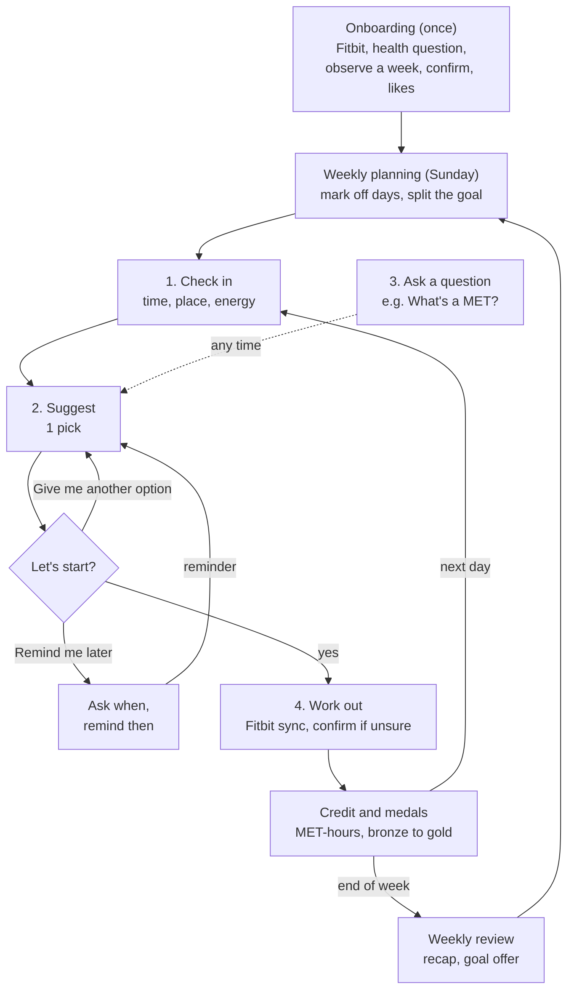

# Make It Count: Personal Health Agent (demo)

A mobile-style web app that takes away decision fatigue for busy adults. Each day it hands the
user one workout that fits their time and the activities they enjoy, counts it in MET-hours toward
the weekly physical activity guideline, and rewards every day they move with a medal.

**Live demo:** https://jarvistseca.github.io/personal-health-agent/ (redeploys on every push to `main`)

This is the **demo build**: every screen is interactive, Fitbit data is simulated, and the coach
answers from pre-written scripts. It follows the team's *PHA App Workflow* doc. The code is organized
so a real LLM and a database can be plugged in later without rewriting the screens.

**Team:** Kate Tan (clinical informatics / CS), Sarah Danziger, MD (medicine / health),
Jarvis Tse (HCI / design / CS)

## Run it

Requires Node 18 or newer.

```bash
npm install
npm run dev
```

Open the URL Vite prints (usually http://localhost:5173). On a laptop you'll see the app inside a
phone frame with demo controls beside it. On a phone (or a narrow window) the app fills the screen.
To try it on your phone, connect to the same Wi-Fi and open the "Network" URL Vite prints.

| Command | What it does |
|---|---|
| `npm run dev` | Start the dev server with hot reload |
| `npm run build` | Typecheck and build to `dist/` |
| `npm run preview` | Serve the built app locally |
| `npm test` | Run the unit tests for the MET-hour math, targets, medals, goal rules, ranker and Today flow |
| `npm run typecheck` | TypeScript check only |

**With the Python backend (Jev + SQLite):** start it on port 8000 as described in
[docs/architecture.md](docs/architecture.md#run-it), then run `npm run dev` as usual. Suggestions then come from Jev
and the app's data is saved in SQLite. Without the backend, the app works exactly as the demo above.

## What's in the demo

The app has five tabs: **Today · Progress · Coach · Clinician · Showcase**. Onboarding runs once before
them, and Preferences opens as a sheet from Today.

### Onboarding (runs once)

**Observe first**: connect Fitbit, answer one health question, watch a week, then confirm what was detected,
add liked activities (ranked), access, usual time and the first weekly plan. *Set up now* skips the week.

### Today

The daily loop, and the screen the app opens on.

- **Summary card:** this week's medals, a bar for the week's MET-hours and one for today's target, and the
  streak. Tapping the streak opens Progress.
- **Summary legend:** the week bar reads *Done* (green), *Left for today* (amber), *Upcoming days* (gray).
- **Check-in:** bubbles for time, where they'll exercise and how they feel (*0 min* offers desk moves).
- **Suggestion:** one pick, three buttons: *Let's start*, *Remind me later* (the coach asks when) and
  *Give me another option* (swaps in the next pick, no reason needed).
- **Questions:** chips such as *What's a MET?*, *Why this?* and *How did you calculate this?* at every step.
- **Workout:** *Sync Fitbit* logs it, asks to confirm if unsure, awards medals and nudges *keep going*.
- **From your clinician:** after a visit, the clinician's note, precautions and goal review date appear here.
- The settings button opens **Preferences**: ranked activities with access, what the coach remembers
  (declines and notes), the health flag, Fitbit, and a shortcut to the Clinician tab.

Code: `src/screens/TodayScreen.tsx`, `src/state/today.ts`, `src/screens/PreferencesSheet.tsx`

### Progress

One tab for how activity adds up. It replaces the old Week tab, Medals tab and weekly recap sheet.
Top to bottom:

- **This week:** MET-hours done against the goal, the goal strip, percent done and what's left, and the
  streak (current and best). The line under the heading says where the goal came from (guideline, raised,
  stepping stone or clinician).
- **Day by day:** each day's medal, target and workouts (from Fitbit or logged). *Change my week* marks days
  *Off*, *Short*, *Medium* or *Long* at any point and re-splits what's left. *Log a workout Fitbit missed*
  adds one by hand.
- **Last week:** the recap: total, medals, a line of praise and the activity with the most time. Below it,
  the goal offer: raise, lower or keep, or type your own goal.
- **Earlier weeks:** every week before that as a row of medals; gold weeks are highlighted.
- **How medals work:** bronze, silver and gold rules, and what ends a streak.

Code: `src/screens/ProgressScreen.tsx`

### Coach

A chat for free-form questions, answered from scripts with the user's real numbers, including the
clinician guardrail for pain or dizziness.

Code: `src/screens/CoachScreen.tsx`, `src/services/mockResponses.ts`

### Clinician

Used at a visit, on the user's own phone, so no clinician account is needed.

- **Consent first.** Every time the tab opens, a pop-up asks: *"Do you want your clinician to help you set
  your exercise goals? If so, please hand your phone to them now, and they will have access to your
  records."* *Not now* goes back to the previous tab. Nothing is shown until the user agrees.
- **Goal template** (dropdowns plus free text):

  | Field | Input |
  |---|---|
  | Name | Free text |
  | Role | Dropdown: physician, nurse practitioner, physician assistant, physical therapist, exercise physiologist, other |
  | Reason for this goal | Dropdown: prevention, blood pressure / heart, blood sugar / diabetes, weight, after injury or illness, pregnancy / postpartum, other |
  | MET-hours per week | Dropdown: keep the app's goal, 3.75, 5, 7.5 (guideline), 10, 15, or a custom number from 1 to 30 |
  | Intensity allowed | Dropdown: moderate and vigorous, or moderate only (under 6 MET) |
  | Longest single session | Dropdown: no limit, 30, 45 or 60 min |
  | Review this goal | Dropdown: in 2 weeks, 4 weeks, 3 months, or at the next visit |
  | Note for the user | Free text |
  | Precautions | Free text |

  A live line converts the goal to minutes, e.g. 7.5 MET-hours ≈ 150 min moderate or 75 min vigorous.
- **Records:** weekly MET-hours against each week's goal, activity mix, why workouts get skipped, and flags
  (health condition, pain reports, longest gap without activity, the open weekly-limit question).
- **Save and hand back** applies the goal and limits, returns to Today and shows the user what changed.
  *Cancel* discards the changes.

Code: `src/screens/ClinicianScreen.tsx`

### Showcase

The **demo moment** from the one-pager. It works without onboarding. Pick two or three activities, see
what 30 minutes of each is worth, and compare three weeks: *too little*, *overdid it* and *with the agent*,
with the agent's plan expandable.

Code: `src/screens/ShowcaseScreen.tsx`

**Typing is always an option.** Every question that offers buttons or bubbles also has an *Other* text box
below them. Typed answers are read into the same choices (`src/lib/freeText.ts`): "25 min", "at the gym",
"my knee is sore" (takes the safety path), "pickleball". Anything the app can't place is kept as a note the
coach remembers (shown in Preferences), and an activity outside the list keeps the user's name for it and counts
at the bottom of the effort band Fitbit measured.

**Demo controls** (right side on desktop): switch scenario (*Alex*, *On a roll* → goal raise, *Tough month*
→ goal cut, *Fresh start*), pretend it's a different day, restart today's check-in, simulate a Fitbit
sync, jump to Progress or the Clinician tab, reset, and show the backend: the **verifier's checks** on the
current suggestion and the prompt the coach would receive.

## Design guidelines

The app is built from the team's design brief and the *PHA App Workflow* doc, including the decisions the
team made on its open questions. The one-line goal behind every feature: **take away decision fatigue by
telling the user what exercise to do.** It's for people with little time, or who don't want to think about
what to do, and once they start moving it encourages them to keep going.

The Workflow subsection shows how the features fit together. Each feature subsection after it gives the
instruction, then how the app follows it.

### Workflow

The app runs on three loops: onboarding once, planning every week, and a check-in every day.



1. **Onboarding (once).** The user connects Fitbit and answers one health question. The app then watches a
   week of Fitbit data. On day 8 the user confirms the workouts the app detected and adds activities they
   enjoy, what they can access, and their usual weekly time.
2. **Weekly planning (every Sunday).** The user marks the days they can't exercise. The weekly goal is split
   over the other days by how much time each one has. The plan can change mid-week, and what's left is
   re-split.
3. **The daily loop.**
   1. *Check in:* the user taps how much time they have, where they'll exercise and how they feel.
   2. *Suggest:* the coach gives one pick with three buttons: *Let's start*, *Remind me later* or *Give me
      another option*. A reason for turning it down can still be typed, and the coach saves it.
   3. *Ask:* at any point the user can tap or type a question, such as *What's a MET?*
   4. *Work out:* Fitbit syncs the workout and the user confirms it if the app isn't sure. It's converted to
      MET-hours, medals update, and if the user got partway to today's target the coach nudges them to keep
      going. The rest of the week's targets adjust.
4. **Weekly review (end of week).** The *Last week* section of Progress shows last week's total and medals,
   then offers to raise, lower or keep the goal. Planning the next week happens in the same tab.

The Clinician tab sits outside these loops. The user opens it during a visit and agrees to share their
records, and what the clinician sets (goal, limits, note, precautions) applies from then on.

### Onboarding

**Instruction:** Learn what the user already does from a week of Fitbit data, then confirm it with them and
ask for anything else they enjoy and can do.

- Observe first is the default: connect Fitbit, answer one health question, then wear the Fitbit for a week
  while the coach makes no suggestions. Medals still count during that week.
- On day 8 the coach shows each workout it detected ("Tuesday, 30 min, looks like cycling. Right?") and the
  user confirms, corrects or skips it.
- Then the user adds activities they enjoy (in order of preference), says whether they can get to each one
  ("Is there a court near you?"), gives their usual weekly time, and plans the first week.
- *Don't want to wait? Set up now* skips the observation week.
- Any health answer other than "No health conditions" turns off vigorous suggestions and suggests checking
  with a clinician first.

Code: `src/screens/Onboarding.tsx`

### Weekly planning and daily targets

**Instruction:** Split the weekly goal across the days the user can exercise. Let them mark days they can't
exercise at all, and let them change the plan mid-week, with the remaining goal split over the remaining days.

- Each day is *Off*, *Short* (10–20 min), *Medium* (about 30) or *Long* (45+).
- The weekly goal never drops because of off days; their share moves to the other days, weighted by time.
- *Change my week* works at any point. Every change, and every Fitbit sync, re-splits what's left.
- Today's target is fixed at the start of the day, so silver is judged against a number that doesn't move
  during a workout.

Code: `src/lib/plan.ts`, `src/screens/ProgressScreen.tsx`

### Daily check-in

**Instruction:** Ask for the user's preferences and availability each day.

- Three quick questions, each answered with one tap: time today (0, 5, 10, 30 or 45+ min), where they'll
  exercise (home, office, outside), and how they feel (*Up for a challenge* or *Normal*).
- There's no "what are you in the mood for?" question: the coach picks, to avoid decision fatigue.
- Feeling tired isn't a button, to nudge toward moving, but typing it works and the pick gets easier.
- *Up for a challenge* aims for 1.5× today's target; *Normal* aims for today's target.
- Answering *0 min* skips the rest and offers desk moves.

Code: `src/state/today.ts`, `src/screens/TodayScreen.tsx`

### Exercise suggestions

**Instruction:** Suggest an exercise for the day that fits the user's preferences, what they can access, their
time and their goal. Avoid repetition. Use their past feedback. If they have no time, suggest something they
can do at their desk.

- One pick on screen. The ranker keeps two backups (of a different type where possible) for *Give me
  another option*, which cycles through them.
- *Remind me later* asks when (in 30 min, in 1 hour, this evening, or a typed time) and brings the same pick
  back then.
- The ranker filters to activities the user enjoys, can access and has time for, and that their health
  settings allow. It then scores them on preference, fit to today's target, how recently each was done, past
  declines and today's energy.
- Each card says why it was picked ("Your favorite", "Not done in the last few days").
- With 0 minutes, it offers desk moves with a resistance band. These earn a bronze medal.

Code: `src/lib/suggest.ts`

### Declining a suggestion

**Instruction:** The user can turn a suggestion down and say why. The coach remembers the reason and uses it
for later suggestions.

- There's no *Not today* button on the pick: typing a reason in the Other box ("my knee hurts", "no time")
  starts it. *Change of plans* on an accepted workout still offers the reasons as bubbles: no time, too tired,
  not in the mood, did this recently, can't access it, weather, something hurts.
- Each reason changes the next pick right away (shorter, lighter, indoors, a different type) and is saved.
  Preferences shows what the coach remembers, and the user can delete any of it.
- *Something hurts* always takes the safety path: gentle options only, vigorous suggestions off, and a
  prompt to check with a clinician.

Code: `src/state/today.ts`, `src/screens/PreferencesSheet.tsx`

### Clarification questions

**Instruction:** The user can ask questions (for example, "What is MET?") at any point.

- One-tap question chips sit under every suggestion: *What's a MET?*, *Why this activity?*, *How did you
  calculate this?*, *Does walking count?*, *Why is my goal 7.5?*
- Answers come from a fixed glossary, the ranker's real reasons and the calculator's real numbers, never
  numbers the coach makes up.
- The Coach tab takes questions in the user's own words.

Code: `src/services/answers.ts`, `src/services/mockResponses.ts`

### Workout detection

**Instruction:** Use Fitbit data to infer what the user did, and ask them to confirm.

- A workout that matches the accepted plan is logged automatically.
- Otherwise the coach asks: "Looks like 32 min of cycling at 6:10 pm. Right?"
- Until it's confirmed, a workout counts conservatively, at the bottom of the effort band Fitbit measured
  (3.0 or 6.0 MET).

Code: `src/state/today.ts`, `src/data/mockFitbit.ts`

### Keeping going and doing more

**Instruction:** Once a user starts, encourage them to keep going. If they want to do more today, suggest a
bigger session and ask less of another day.

- When a workout gets at least halfway to today's target, the coach sends one nudge: "8 more minutes
  finishes it."
- *Up for a challenge* at check-in offers a bigger session (aiming for 1.5× today's target), and the rest of
  the week's targets drop to match.

Code: `src/state/today.ts`

### Medals and streaks

**Instruction:** Any exercise earns a bronze medal for the day. Reaching the daily goal earns silver. Reaching
the weekly goal turns every medal that week gold. A screen shows the streak as medals.

- Light activity, such as a short walk or desk moves, counts toward bronze.
- The streak counts days in a row with at least a bronze. Any day with no activity ends it, even a planned
  day off.
- The Progress tab shows the streak and every week as a row of coins.

Code: `src/lib/medals.ts`, `src/screens/ProgressScreen.tsx`

### Goal setting and adjustment

**Instruction:** The default weekly goal is 7.5 MET-hours. Adjust it up or down based on the user's past
weeks.

- 7.5 MET-hours equals the activity guideline: 150 min at 3 MET or 75 min at 6 MET.
- **Raise:** take the lower of the last 2 weeks and round it down to a multiple of 2.5. If that's above the
  current goal, offer it.
- **Lower:** if the user is under half the goal 3 weeks in a row, offer half the goal.
- The same rules apply at every goal level, including below 7.5. A goal below 7.5 is labeled a stepping stone.
- The *Last week* section of Progress makes the offer and the user accepts, keeps or types their own goal.
  A goal set by a clinician is never changed automatically.

Code: `src/lib/goal.ts`, `src/screens/ProgressScreen.tsx`

### Clinician tab

**Instruction:** A separate screen where a clinician can check the user's exercise records and set a goal.

- The user hands their phone to the clinician during a visit, so no clinician account is needed.
- Opening the tab always asks for consent first; the records stay hidden until the user agrees.
- The goal template uses dropdowns for structured fields (role, reason, MET-hours per week, intensity,
  session length, review date) and free text for the name, a note and precautions.
- The goal, intensity and session limits feed the verifier's checks. A clinician goal is never changed
  automatically by the goal rules.
- On hand-back the user sees a summary of what changed, and Today shows the note and precautions.

Code: `src/screens/ClinicianScreen.tsx`

### Tap first, type anytime

**Instruction:** Show option bubbles so users rarely have to type, but always let them type their own answer.

- Every question offers bubbles or buttons, with an *Other* text box below them.
- Typed answers become the same choices the bubbles make ("25 min", "Thursday off, Saturday long", "my knee
  hurts").
- Anything the app can't place is saved as a note the coach remembers. An activity that isn't in the list
  keeps the user's name for it.

Code: `src/lib/freeText.ts`, `src/components/OtherInput.tsx`

### Two agents and guardrails

**Instruction:** Use two agents in the back end to check each other's work, while the user talks to only one.
Add a guardrail to check calculation outputs. Describe each agent's task in natural language.

- The coach talks to the user. A verifier checks each suggestion before the user sees it.
- All numbers come from plain code (the calculator), never from a language model.
- The verifier checks the MET source, the arithmetic, the time fit, preferences, repetition, safety limits and
  session length. The demo panel shows its results.
- Each agent's task is written as a short plain-English brief that anyone on the team can edit.

Code: `src/lib/verify.ts`, `src/services/prompts.ts`

### Not built yet

These are in the brief but not in the demo: importing the user's schedule, using location to know which
activities are nearby, and using weather to swap in indoor options.

### Questions for clinical review

These need clinical input before the app is used with real users. Until they're answered, the app takes the
cautious option shown for each one.

| Question | Why it matters | What the app does for now |
|---|---|---|
| **Light activity and the goal.** Should activity under 3 MET (a slow walk, desk band sets) count toward the weekly MET-hour goal, or only earn a medal? | The activity guideline counts only moderate (3+ MET) and vigorous (6+ MET) activity, but desk moves are the only option on 0-minute days. | Light activity earns a bronze medal and keeps the streak, but adds nothing to the goal. Setting: `LIGHT_COUNTS_TOWARD_GOAL` in `src/lib/met.ts` (off). |
| **Weekly upper limit.** Is there an evidence-based upper limit on weekly MET-hours? | It sets when the coach stops "keep going" nudges and suggests rest, which weeks get flagged in the Clinician tab, and how high an automatic goal raise can go. | No limit is set. Raises follow the rounding rule only, and the Clinician tab says the limit isn't set yet. Setting: `WEEKLY_UPPER_LIMIT` in `src/lib/goal.ts` (`null`). |
| **Floor for goal cuts.** Halving after 3 low weeks can repeat. Below what goal should the app stop cutting and suggest talking with a clinician instead? | Repeated halving could take the goal far below anything meaningful without anyone reviewing it. | No floor. Each cut is only an offer the user must accept, and any goal below 7.5 is labeled a stepping stone back to the guideline. |

The same list is at the end of the *PHA App Workflow* doc.

## How the numbers work

- **MET-hours = MET × minutes ÷ 60**, with MET values from the [2024 Adult Compendium of Physical Activities](https://pacompendium.com/adult-compendium/) (`src/lib/activities.ts`).
- **Weekly goal: 7.5 MET-hours** = 150 min at 3 MET = 75 min at 6 MET. Only activity ≥ 3 MET counts by default (`LIGHT_COUNTS_TOWARD_GOAL` in `src/lib/met.ts`, an open clinical question). Unconfirmed Fitbit bouts count at 3.0 or 6.0 MET, the bottom of their band.
- **Daily targets** (`src/lib/plan.ts`): what's left, split over the remaining available days by their time. Off days never lower the weekly goal. Today's target is fixed at the start of the day.
- **Medals** (`src/lib/medals.ts`): bronze for any activity, silver for the day's target, gold for every medal once the weekly goal is met. The streak needs a medal every day.
- **Goal rules** (`src/lib/goal.ts`): raise to the lower of the last 2 weeks rounded down to a multiple of 2.5 (if higher); after 3 weeks under 50%, offer half. A clinician-set goal never changes automatically. `WEEKLY_UPPER_LIMIT` is `null` until the clinical question is answered.
- **Suggestions** (`src/lib/suggest.ts`): filter (enjoyed, accessible, fits time, safe) → score (preference, goal fit, variety, past declines, energy) → one lead and two backups of a different type. Every suggestion passes the checks in `src/lib/verify.ts`.

## Project layout

```
src/
  lib/            Pure logic, unit-tested: activities + MET values, MET-hours, daily targets,
                  medals, goal rules, suggestion ranker, verifier checks
  data/           Demo scenarios: 4 past weeks + this week each (shaped like PMData exercise logs)
  services/
    agent.ts        Agent interface; MockAgent (today) and HttpAgent (example for later)
    answers.ts      Grounded answers to the one-tap questions
    mockResponses.ts  The pre-written Coach-tab script. Edit this to change demo answers
    context.ts      Builds the structured user context the agent sees
    prompts.ts      Plain-English task briefs for the coach and verifier agents
    store.ts        Persistence; localStorage today, swap for a database later
  state/          App state (React context + reducer), the Today flow (today.ts), shared types
  screens/        One file per screen / bottom sheet
  components/     Medal coins, goal strip, icons, sheet, demo panel
docs/architecture.md   How to add the LLM and database
```

## Next steps

See [docs/architecture.md](docs/architecture.md) for the plan to connect a real LLM and a database,
and [CONTRIBUTING.md](CONTRIBUTING.md) for how we work in this repo.

## Disclaimer

Research prototype for demonstration only. Not medical advice.
